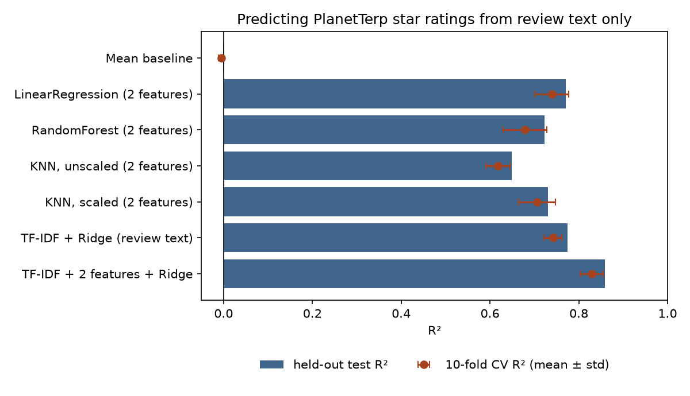

# Professor Rating Prediction

[](https://github.com/iwang-1/professor-rating-prediction/actions/workflows/ci.yml)

Predicting a professor's average star rating on [PlanetTerp](https://planetterp.com/) from the **text of
their reviews only** — the star ratings are never used as features.

On a committed snapshot of 2,144 professors, a Ridge model over TF-IDF review text plus two summary
features explains **86% of the variance** in ratings on held-out professors (test R² 0.859, 10-fold CV
0.829), with a mean absolute error of **0.28 stars**. The original two-feature linear model reaches 0.771.



## Results

Snapshot of the PlanetTerp public API taken 2026-11-13: 4,651 professors with an average rating, 2,144
of them with at least 5 written reviews (the modeling sample). Seeded 80/20 split; 10-fold CV
(shuffled, seeded) on the training split. Regenerated by `python -m prof_ratings evaluate`, which writes
[`results/model_comparison.csv`](results/model_comparison.csv); CI re-runs it and fails if the table
changes.

| Model | Features | Test R² | Test MAE (stars) | 10-fold CV R² |
|---|---|---:|---:|---|
| Mean baseline | none | −0.001 | 0.841 | −0.006 ± 0.006 |
| LinearRegression | 2 features | 0.771 | 0.365 | 0.739 ± 0.038 |
| RandomForest | 2 features | 0.722 | 0.399 | 0.679 ± 0.050 |
| KNN, unscaled | 2 features | 0.649 | 0.453 | 0.618 ± 0.028 |
| KNN, scaled | 2 features | 0.730 | 0.397 | 0.706 ± 0.041 |
| TF-IDF + Ridge | review text | 0.774 | 0.370 | 0.742 ± 0.020 |
| **TF-IDF + 2 features + Ridge** | text + 2 features | **0.859** | **0.275** | **0.829 ± 0.026** |

The **2 features** are `review_count` and `avg_comment_sentiment` (mean VADER compound score over a
professor's reviews). TF-IDF uses word unigrams and bigrams over all of a professor's review text
(`min_df=3`, sublinear term frequency); the vectorizer and scaler are fit inside each training fold, so
no test text informs the features.

What the table shows:

- **Text and sentiment carry different signal.** TF-IDF alone and the two features alone score about the
  same (0.774 vs 0.771), but together they reach 0.859 — the combination is better than either, so the
  word-level features capture something the single sentiment average does not (and vice versa).
- **KNN's weak original result was a scaling problem.** `review_count` spans hundreds while sentiment
  spans −1 to 1, so unscaled distances ignore sentiment. Standardizing the features lifts KNN from 0.649
  to 0.730.
- **The original project's numbers reproduce.** The original slides reported LinearRegression 0.7879,
  RandomForest 0.7323, and KNN 0.6473 on a different, unseeded split of an earlier snapshot; this run
  gives 0.771, 0.722, and 0.649.
- **Random Forest still overfits two features**, as in the original analysis: 0.722 vs 0.771 for a line.

## How to run

```bash
pip install -r requirements.txt
python -m prof_ratings evaluate      # uses the committed snapshot; about 1 minute
python -m pytest -q tests            # offline unit tests on synthetic data
python -m prof_ratings fetch         # optional: download a fresh snapshot (several minutes)
```

`evaluate` prints the table above, and writes `results/model_comparison.csv` and
`docs/model_comparison.png`. A fresh `fetch` replaces the committed snapshot, so its numbers will drift
as students post new reviews.

## Repository contents

| Path | Description |
|---|---|
| `prof_ratings/data.py` | PlanetTerp API client (retries with backoff, thread pool) and snapshot I/O |
| `prof_ratings/model.py` | Feature building and the seeded evaluation of every model |
| `prof_ratings/plots.py` | The comparison figure, written to a file |
| `prof_ratings/__main__.py` | `fetch` / `evaluate` command line |
| `data/planetterp_snapshot.csv.gz` | Snapshot of public PlanetTerp ratings and review text (2026-11-13) |
| `results/model_comparison.csv` | The results table |
| `tests/` | Offline unit tests |
| `legacy/predict_ratings_original.py` | The original single-script version, kept for reference |
| `WRITEUP.md` | The original project write-up |

## Data

All data comes from the [PlanetTerp public API](https://planetterp.com/api/v1), which needs no API key.
The snapshot holds each professor's name, PlanetTerp slug, average rating, and the text of their public
reviews; it holds no information about the students who wrote them.

## License

MIT — see [`LICENSE`](LICENSE).
